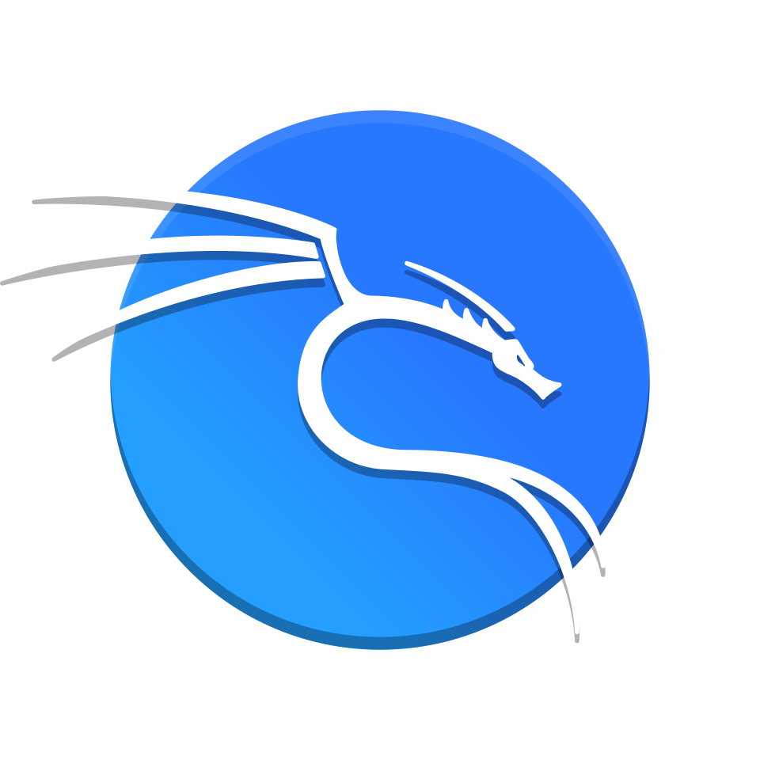

# About Me:
Currently working on homelab infrastructure, servers, networking and cybersecurity.  Looking to collaborate on cybersecurity, server infrastructure and web development.  Looking for help with advanced networking and security challenges.  Currently learning ethical hacking, network security and virtualization.  Ask me about Proxmox, Linux, Windows Server, networking, Wireshark, Nmap, firewalls and homelabs.  Fun fact: Building my own homelab with enterprise server hardware and network equipment.

## Socials:
 

# Tech Stack:

  &nbsp;&nbsp;
  &nbsp;&nbsp;
  &nbsp;&nbsp;
  &nbsp;&nbsp;
  &nbsp;&nbsp;
  &nbsp;&nbsp;
  &nbsp;&nbsp;
  &nbsp;&nbsp;
  &nbsp;&nbsp;
  &nbsp;&nbsp;
  &nbsp;&nbsp;
  &nbsp;&nbsp;
  &nbsp;&nbsp;
  &nbsp;&nbsp;
  &nbsp;&nbsp;
  &nbsp;&nbsp;
  &nbsp;&nbsp;
  &nbsp;&nbsp;
  &nbsp;&nbsp;
  

# Familiar Operating Systems & Distros:

  &nbsp;&nbsp;
  &nbsp;&nbsp;
  &nbsp;&nbsp;
  &nbsp;&nbsp;
  &nbsp;&nbsp;
  &nbsp;&nbsp;
  &nbsp;&nbsp;
  &nbsp;&nbsp;
  

